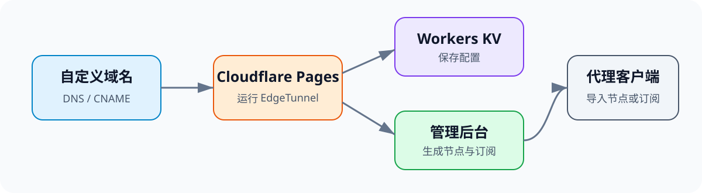
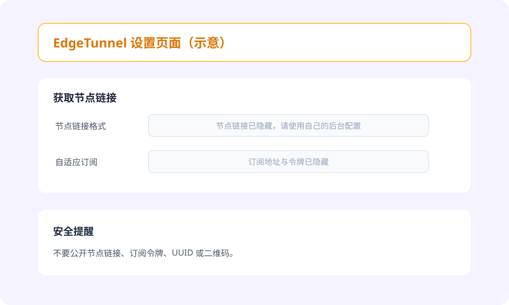

# Cloudflare Pages 部署 EdgeTunnel 图文教程

这篇教程记录如何使用 **Cloudflare Pages、Workers KV 和 EdgeTunnel** 部署个人代理服务。整个方案不需要购买 VPS，适合希望学习 Cloudflare 部署和开源项目配置的用户。

> **合规提示**：请遵守所在地法律法规，以及 Cloudflare、域名服务商和开源项目的服务条款。原教程特别提示中国大陆用户不要使用该方案。免费额度、平台政策和项目功能都可能变化，本文不承诺永久免费或永久可用。

## 部署结构



整体流程如下：

```text
准备域名
→ 托管到 Cloudflare
→ 创建 KV 命名空间
→ 部署 EdgeTunnel 到 Pages
→ 设置 ADMIN 环境变量
→ 绑定 KV
→ 绑定自定义域名
→ 登录后台并导入客户端
```

## 一、准备工作

开始前需要准备：

- 一个 [Cloudflare](https://www.cloudflare.com/) 账号；
- 一个可以修改 DNS 的域名或子域名；
- [EdgeTunnel](https://github.com/cmliu/edgetunnel) 项目文件；
- 支持相应协议的客户端，例如 [v2rayN](https://github.com/2dust/v2rayN)、Clash 或 sing-box。

下载项目：

- [EdgeTunnel 项目主页](https://github.com/cmliu/edgetunnel)
- [main 分支 ZIP 压缩包](https://github.com/cmliu/edgetunnel/archive/refs/heads/main.zip)

部署第三方项目前，应先检查源码、项目文档和更新记录，不建议使用来源不明的修改版。

## 二、注册免费域名

如果已经有自己的域名，可以跳过这一步。

原教程提供了两个免费域名服务：

- [DNSHE](https://www.dnshe.com/)
- [DigitalPlat](https://digitalplat.org/)

这里以 DNSHE 为例。注册并登录后，选择平台提供的免费后缀。原教程演示了 `ccwu.cc` 和 `us.ci`，实际可选后缀及注册数量以平台当前规则为准。


注册完成后，可以在域名管理页面查看自己的域名。


> 免费域名同样受服务商规则约束。用于正式或长期项目时，使用自己注册的域名通常更可控。

## 三、将域名托管到 Cloudflare

登录 Cloudflare，将域名添加到账号中，并按照页面提示修改名称服务器或完成 DNS 托管。

等待域名状态正常后，再继续后续操作。


## 四、创建 KV 命名空间

EdgeTunnel 使用 KV 保存相关配置。

进入 Cloudflare 控制台，依次打开：

**存储和数据库 → Workers KV**

创建一个新的 KV 命名空间，例如：

```text
edgetunnel-kv
```


创建完成后暂时不需要手动添加数据，后面将它绑定到 Pages 项目即可。

## 五、创建 Pages 项目

进入：

**Workers 和 Pages → 创建**


选择 Pages 部署入口，再选择直接上传项目资产。


填写项目名称，上传前面下载的 EdgeTunnel 项目压缩包，然后点击“部署站点”。


首次部署完成后，还需要配置管理员密码和 KV 绑定。

## 六、设置管理员密码

打开刚创建的 Pages 项目，进入：

**设置 → 环境变量 → 生产环境 → 添加变量**

添加：

| 配置项 | 内容 |
|---|---|
| 变量名 | `ADMIN` |
| 变量值 | 自定义的高强度管理员密码 |

注意：

- 变量名必须是大写 `ADMIN`；
- 密码不要与其他网站共用；
- 不要把真实密码写进公开截图或仓库。

保存后返回“部署”页面，选择“创建新部署”，重新上传项目文件并部署，让环境变量生效。

## 七、绑定 KV 命名空间

继续在 Pages 项目中进入：

**设置 → 绑定 → 添加 → KV 命名空间**

填写：

| 配置项 | 内容 |
|---|---|
| 变量名称 | `KV` |
| KV 命名空间 | 前面创建的 `edgetunnel-kv` |

变量名称必须使用大写 `KV`，否则程序可能无法正确读取存储空间。

保存绑定后，再创建一次新部署，确保配置生效。

## 八、绑定自定义域名

进入 Pages 项目的：

**自定义域 → 设置自定义域**

填写准备使用的域名或子域名，例如：

```text
node.example.com
```

如果 Cloudflare 提示手动添加 CNAME 记录，就前往域名的 DNS 管理页面，将该记录指向 Pages 提供的项目地址，通常类似：

```text
你的项目名称.pages.dev
```

如果域名已经托管在同一个 Cloudflare 账号中，平台通常可以自动完成相应配置。保存后等待域名激活和 DNS 生效。

## 九、登录管理后台

域名生效后，访问：

```text
https://你的域名/admin
```

输入设置在 `ADMIN` 变量中的密码，即可进入管理后台。

后台可以查看节点链接和自适应订阅地址。根据客户端支持的格式，选择节点链接或订阅地址即可。



> 节点链接和订阅地址可能包含 UUID、令牌等敏感信息，不要公开发布。后台图片为重新绘制的示意图，不包含真实节点信息。

## 十、导入代理客户端

将后台生成的节点链接或订阅地址导入兼容客户端。原教程使用 v2rayN 演示，导入后可以在客户端中看到相应配置。


如果客户端无法识别订阅，应检查：

- 客户端是否支持所选协议；
- 订阅地址是否完整复制；
- 订阅格式是否与客户端匹配；
- 本地网络是否能够访问对应域名。

## 十一、可选高级设置

项目后台还提供 ProxyIP、订阅转换等高级选项。这些功能不是基础部署的必需步骤，建议先确认默认配置能够正常工作，再逐项调整。


使用第三方订阅转换或 ProxyIP 服务时，需要额外评估其可靠性和隐私风险，不要向不可信服务提交私人订阅信息。

## 十二、常见问题

### 无法登录管理后台

检查：

- 环境变量是否命名为大写 `ADMIN`；
- 是否添加到了生产环境；
- 设置变量后是否重新部署；
- 输入的密码是否包含多余空格。

### 配置无法保存

检查：

- KV 绑定变量名是否为大写 `KV`；
- 是否选择了正确的 KV 命名空间；
- 保存绑定后是否重新部署。

### 自定义域名无法访问

检查：

- CNAME 是否指向正确的 Pages 项目地址；
- DNS 记录是否存在冲突；
- 自定义域是否已在 Pages 中激活；
- DNS 是否仍在等待生效。

### 后台正常，但客户端无法连接

检查客户端协议支持、订阅内容和本地网络，同时查看项目文档及 Cloudflare 当前的使用限制。实际速度和稳定性会受到网络环境、平台政策和配置方式影响。

## 安全建议

- 使用独立、高强度的 `ADMIN` 密码；
- 不公开节点链接、订阅令牌、UUID 和二维码；
- 定期检查 EdgeTunnel 项目更新及安全说明；
- 不在公开截图中展示账号邮箱、域名管理信息或内部标识；
- 谨慎使用第三方订阅转换和 ProxyIP 服务；
- 不再使用时，及时清理 Pages 项目、KV 绑定及不再需要的 DNS 记录。

## 参考与配图来源

- 教程参考：[零度博客原教程](https://www.freedidi.com/23618.html)
- 开源项目：[cmliu/edgetunnel](https://github.com/cmliu/edgetunnel)
- 客户端示例：[2dust/v2rayN](https://github.com/2dust/v2rayN)

本文根据原教程重新整理，删除了广告和无法保证的宣传性描述。普通步骤截图引用自原教程，仅用于说明操作位置，相关权利归原作者所有；Cloudflare 和项目后台界面可能随版本更新而变化。部署结构图与后台示意图为本文重新绘制。
